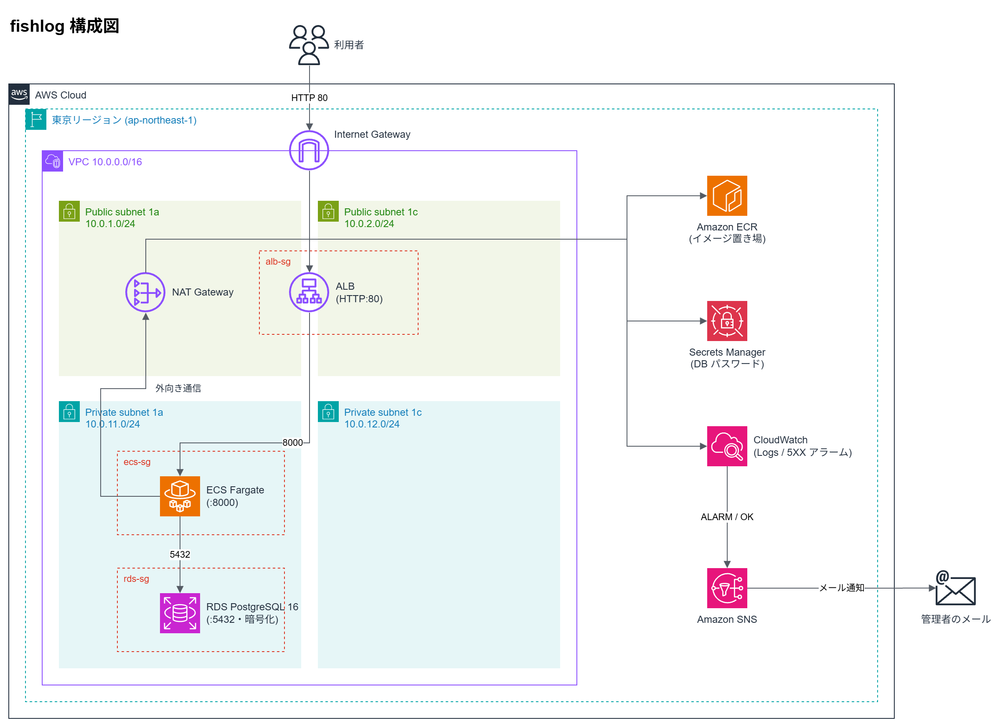

# fishlog

釣果（いつ・どこで・何を釣ったか）を記録する CRUD API と、それを動かす AWS インフラ一式です。
アプリは FastAPI + PostgreSQL、インフラは Terraform で構成をすべてコード化しています。

ネットワーク／セキュリティのインフラエンジニアが、クラウドでの設計・構築・監視を一通り自分で行うことを目的に作りました。

## 構成図



- 外から届くのは ALB だけです。アプリ（ECS Fargate）と DB（RDS）は private サブネットに置いています。
- セキュリティグループは IP ではなく SG 参照で、「ALB → アプリ:8000」「アプリ → DB:5432」だけを許可しています。
- アプリがエラー（5XX）を返すと、CloudWatch アラーム → SNS でメール通知します。

## 使用技術

| 分類 | 技術 |
| --- | --- |
| アプリ | Python 3.12 / FastAPI / SQLAlchemy / uvicorn |
| DB | PostgreSQL 16（ローカルは Docker Compose、AWS は RDS） |
| コンテナ | Docker / Amazon ECR / Amazon ECS（Fargate） |
| ネットワーク | VPC（2AZ、public / private サブネット）/ Internet Gateway / NAT Gateway / ALB |
| セキュリティ | セキュリティグループ / Secrets Manager / IAM（最小権限） |
| 監視 | CloudWatch Logs / CloudWatch アラーム / SNS |
| IaC | Terraform（AWS provider ~> 6.0） |

## ディレクトリ構成

```
fishlog/
├── app/                    # FastAPI アプリ
│   ├── main.py             # API のエンドポイント
│   ├── models.py           # テーブル定義
│   ├── schemas.py          # 入出力の型と入力チェック
│   ├── database.py         # DB 接続（ローカルは DATABASE_URL、AWS は DB_* 環境変数）
│   └── Dockerfile
├── docker-compose.yml      # ローカル用（アプリ + PostgreSQL）
├── docs/
│   ├── architecture.drawio # 構成図の編集用ファイル
│   └── architecture.png
└── terraform/
    ├── main.tf             # provider、共通タグ
    ├── variables.tf        # region / project / alert_email
    ├── network.tf          # VPC、サブネット、IGW、NAT、ルートテーブル
    ├── security.tf         # セキュリティグループ（alb / ecs / rds）
    ├── database.tf         # RDS PostgreSQL
    ├── ecr.tf              # ECR リポジトリ
    ├── ecs.tf              # ECS クラスター、タスク定義、サービス、IAM、ログ
    ├── alb.tf              # ALB、ターゲットグループ、リスナー
    ├── sns.tf              # 通知用 SNS トピックとメール購読
    ├── monitoring.tf       # CloudWatch アラーム（ALB の Target 5XX）
    └── outputs.tf
```

## API

| メソッド | パス | 内容 |
| --- | --- | --- |
| GET | `/health` | ヘルスチェック |
| POST | `/catches` | 釣果を登録 |
| GET | `/catches` | 一覧（釣った日の新しい順） |
| GET | `/catches/{id}` | 1件取得 |
| PUT | `/catches/{id}` | 更新 |
| DELETE | `/catches/{id}` | 削除 |

`/docs` で API ドキュメント（Swagger UI）を見られます。

## 設計で決めたこと

| 決めたこと | 理由 |
| --- | --- |
| ALB だけ public、アプリと DB は private | 外から届く入口を ALB だけにして、攻撃される面を減らすため。DMZ と内部セグメントを分けるのと同じ考え方です |
| SG は IP ではなく SG 参照で許可 | Fargate のタスクは起動し直すたびに IP が変わるため。SG 参照なら IP が変わってもルールを直さずに済みます |
| DB パスワードは RDS に生成させ、Secrets Manager で管理 | コード・tfvars・手元のどこにもパスワードを置かないため。アプリは起動時に IAM ロールで取り出します。IAM はこのシークレット1つを読む権限だけです |
| アプリの実行環境は ECS Fargate | OS の管理やパッチ当てが不要で、ローカルで動いたコンテナがそのまま動くため。EC2 より運用が軽く、App Runner より自分でネットワークを設計できます |
| RDS は暗号化あり・非公開 | 暗号化はあとから有効にできず作り直しになるため、最初から有効にしました |
| 構成はすべて Terraform で管理 | 同じ構成を何度でも再現でき、変更前に plan で差分を確認できるため |
| 監視はアプリの 5XX を1本、ALARM と OK の両方を通知 | 利用者が実際に困っている状態をいちばん直接表す指標のため。データがないとき（アクセスがないとき）は正常扱い（notBreaching）にして誤報を防いでいます |
| AWS への認証は短期認証（`aws login`） | 漏れたら危ない長期のアクセスキーを作らないため |

### コストのために割り切ったこと

学習用なので、可用性とコストは割り切っています。どれも弱点は把握していて、本番ならどうするかも決めています。

| 割り切ったこと | 弱点 | 本番なら |
| --- | --- | --- |
| NAT Gateway は 1a に1台 | 1a が落ちると private から外に出られない | AZ ごとに NAT を置く、または VPC エンドポイントを使う |
| ECS タスクと RDS は 1a に1つずつ | AZ 障害でサービスが止まる | タスクを 2AZ に分散し、RDS は Multi-AZ にする |
| RDS のバックアップなし、削除時のスナップショットなし | データが残らない | バックアップを有効にし、削除保護をかける |
| HTTP（80）のみ | 通信が暗号化されない | Route 53 + ACM で HTTPS にし、80 は 443 へリダイレクト |

## 動かし方

### ローカルで動かす

必要なもの：Docker Desktop

```powershell
git clone https://github.com/shun0330/fishlog.git
cd fishlog
docker compose up --build
```

http://localhost:8000/docs を開くと API を試せます。止めるときは `Ctrl + C` → `docker compose down` です。

`docker-compose.yml` に書いてある DB のユーザー名とパスワードは、手元の PC の中だけで使うローカル用です。AWS 上の DB のパスワードは RDS が生成し、Secrets Manager で管理しています（コードには出てきません）。

### AWS に構築する

必要なもの：AWS アカウント、AWS CLI v2（`aws login` が使える新しめのバージョン）、Terraform 1.6 以上、Docker Desktop

コマンドは Windows の PowerShell を前提にしています。リージョンは東京（ap-northeast-1）です。

**1. AWS にログインする**

アクセスキーは作らず、`aws login` の短期認証を使います。プロファイルを用意し、リージョンは `ap-northeast-1` にしておきます（設定方法は AWS CLI のドキュメントの `aws login` の項を参照してください）。

```powershell
$env:AWS_PROFILE = "<自分のプロファイル名>"
aws login
aws sts get-caller-identity   # ログインできたかの確認
```

ブラウザが開かない環境や、400 エラーになる場合は `aws login --remote` を使います。

**2. 変数ファイルを用意する**

```powershell
cd terraform
Copy-Item terraform.tfvars.example terraform.tfvars
```

`terraform.tfvars` を開き、`alert_email` にアラームの通知先メールアドレスを書きます。このファイルは `.gitignore` で Git から除外しています。

**3. 初期化して、先に ECR だけ作る**

```powershell
terraform init
terraform apply '-target=aws_ecr_repository.app'
```

ECS はイメージが ECR にないと起動に失敗し続けるため、先に ECR を作ってイメージを入れます。

**4. イメージを build して ECR に push する**

```powershell
$repo = terraform output -raw ecr_repository_url
$registry = $repo.Split('/')[0]
aws ecr get-login-password --region ap-northeast-1 | docker login --username AWS --password-stdin $registry

cd ..
docker build --platform linux/amd64 -t fishlog ./app
docker tag fishlog "${repo}:latest"
docker push "${repo}:latest"
cd terraform
```

Fargate は X86_64 で動かす設定なので、`--platform linux/amd64` を付けています。Apple Silicon の Mac でこれを付けないと arm64 のイメージになり、タスクが起動しません。

**5. 全体を作る**

```powershell
terraform apply
```

RDS の作成に5分ほどかかります。完了後、アラーム通知先のメールに「AWS Notification - Subscription Confirmation」が届くので、本文の「Confirm subscription」を押して購読を承認します。

**6. 動作確認する**

まず、アプリが起動して安定するまで待ちます（数分かかります。終わるとプロンプトが戻ります）。

```powershell
aws ecs wait services-stable --cluster fishlog-cluster --services fishlog-service --region ap-northeast-1
```

続けて API を叩きます。

```powershell
$url = terraform output -raw alb_url
Invoke-RestMethod "$url/health"
Invoke-RestMethod "$url/catches" -Method Post -ContentType "application/json" -Body '{"fish":"aji","size_cm":21.5,"place":"Yokosuka","caught_on":"2026-11-07"}'
Invoke-RestMethod "$url/catches"
```

通知のテストは、アラームの状態だけを手動で ALARM にして行います（実際に障害は起こしません）。

```powershell
aws cloudwatch set-alarm-state --alarm-name fishlog-alb-target-5xx --state-value ALARM --state-reason "manual test" --region ap-northeast-1
```

ALARM のメールが届き、数分後に OK に戻ると復旧のメールが届きます。

**7. 削除する**

```powershell
terraform destroy
```

## コスト

NAT Gateway、ALB、RDS、Fargate は、アクセスがなくても置いておくだけで時間課金されます。つけっぱなしにすると月に数千円〜1万円程度（概算）かかるため、普段は `terraform destroy` で全部消しておき、必要なときだけ構築しています。

構成がすべてコードになっているので、消しても約30分で同じ環境を再現できます。

## つまずいたこと・学んだこと

| つまずき・疑問 | 原因 | 対応・学び |
| --- | --- | --- |
| `aws login` が 400 エラーになる | ブラウザ連携の方式が環境に合わなかった | `aws login --remote`（URL を開いて表示されたコードを貼る方式）で回避した |
| ECR への `docker login` が "stub received bad data" で失敗する | Docker の認証情報ヘルパーが ECR のホストでうまく動かなかった | `~/.docker/config.json` の `credHelpers` に ECR のホストを `""` で追加して、そのホストだけヘルパーを使わないようにした。ほかの設定はそのまま残した |
| ECR と ECS を一度に作ると、タスクが起動に失敗し続ける | ECS が起動するときに、ECR にまだイメージがない | ECR だけ先に `-target` で作ってイメージを push し、そのあと全体を作る順番にした |
| アクセスがないと、アラームが「データ不足」になる | 5XX が 0 回のときは、CloudWatch にデータ自体が送られない | `treat_missing_data = "notBreaching"` で「データなし＝正常」として扱うようにした |
| 通知が本当に届くか、障害を起こさずに確かめたい | — | `aws cloudwatch set-alarm-state` で状態だけを ALARM にして、メールの受信と OK への復帰を確認した |
| 置いておくだけで課金されるリソースがある | NAT Gateway、ALB、RDS、Fargate は時間課金 | apply した日のうちに destroy する運用にした。Terraform なら消しても同じ構成をすぐ再現できる |

## 今後の改善

- HTTPS 化（Route 53 + ACM）
- AWS WAF で ALB の前に攻撃対策を入れる
- CI/CD（GitHub Actions で `terraform fmt -check` / `validate`、イメージの自動 build・push）
- Terraform のモジュール分割と、tfstate の S3 管理
- NAT Gateway の冗長化（または VPC エンドポイント）、ECS タスクの 2AZ 分散、RDS の Multi-AZ
